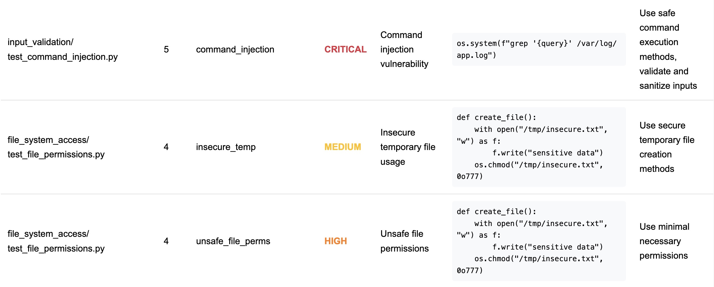

# Agent Security Scanner

A command-line tool designed to scan LLM agent configurations and code (supporting LangChain, AutoGen, YAML, and Python files) to identify potential security risks and vulnerabilities. It analyzes tool usage, permissions, configurations, and code patterns to generate a comprehensive security report.

## Key Features

-   **Broad Framework Support:** Scans configurations and code for popular agent frameworks like LangChain, AutoGen, and CrewAI.
-   **Multiple Format Analysis:** Supports direct scanning of Python (`.py`) files and YAML (`.yaml`, `.yml`) configuration files.
-   **Code Intelligence:** Utilizes Abstract Syntax Trees (AST) for deeper, more accurate analysis of Python code.
-   **Configuration Awareness:** Performs pattern matching within YAML files for insecure settings.
-   **n8n Workflow Scanning:** Analyzes n8n workflow JSON files for common security vulnerabilities, including risky node configurations (e.g., Code, Execute Command nodes) and potential credential exposure.
-   **Git Repository Scanning:** Can directly scan agent configurations hosted in Git repositories.
-   **Comprehensive Risk Detection:** Identifies security issues including dangerous tool usage, code execution, file system access, and network vulnerabilities.
-   **Detailed Reporting:** Generates reports with risk levels (Critical, High, Medium, Low), descriptions, and remediation advice.
-   **Flexible Output:** Provides reports in console format, JSON (`--output`), and CSV (`--output-csv`).
-   **False Positive Management:** Allows ignoring specific findings via a `.agent_security_ignore` file.
-   **Enhanced Security:** Implements safe YAML loading, path validation, and improved pattern detection.
-   **Docker Support:** Run the scanner in an isolated environment with all dependencies properly installed.
-   **HTML Reports:** Generate a detailed HTML report with color-coded findings.

## Installation

### Option 1: Direct Installation

```bash
# Clone the repository (if you haven't already)
# git clone <repository-url>
# cd agent-security-scanner

# Install dependencies
pip install -r requirements.txt

# Optional: Install the package locally for easier CLI access
# pip install .
```

### Option 2: Using Virtual Environment (Recommended)

```bash
# Clone the repository (if you haven't already)
# git clone <repository-url>
# cd agent-security-scanner

# Create a virtual environment
python -m venv venv

# Activate the virtual environment
## On macOS/Linux:
source venv/bin/activate
## On Windows:
# .\venv\Scripts\activate

# Install dependencies
pip install -r requirements.txt

# Optional: Install the package locally for easier CLI access
# pip install .

# When you're done, you can deactivate the virtual environment
# deactivate
```

Using a virtual environment is recommended as it:
- Isolates the project dependencies from your system Python packages
- Prevents conflicts between different project requirements
- Makes it easier to manage and track dependencies
- Ensures a clean, reproducible environment for the scanner

## Usage

There are three ways to run the scanner:

### 1. Direct Python Usage

Run the scanner directly using Python:

```bash
# Basic usage
python -m agent_security scan <target>

# Example: Scan a YAML file
python -m agent_security scan ./examples/vulnerable_yaml_openAgent.yaml

# Example: Scan with options
python -m agent_security scan ./examples/langchain_agent.py --explain
```

### 2. Docker with Built-in Examples

Run the scanner using Docker with the built-in example files:

```bash
# Build the Docker image
docker build -t agent-security .

# Scan a built-in example
docker run agent-security examples/vulnerable_yaml_openAgent.yaml

# Scan a built-in example with options
docker run agent-security examples/va.yaml --explain
```

### 3. Docker with Local Files

Run the scanner using Docker with your local files:

```bash
# Mount your current directory and scan a file
docker run -v "$(pwd)":/scan agent-security /scan/path/to/your/file.yaml

# Mount a specific directory and scan it
docker run -v "/path/to/your/code":/scan agent-security /scan

# Example with a specific file and options
docker run -v "$(pwd)":/scan agent-security /scan/examples/vulnerable_yaml_openAgent.yaml --output report.json
```

**Note:** When using Docker with local files:
- The directory containing your files must be mounted to `/scan` in the container
- All paths in your commands should be relative to the `/scan` directory
- If your path contains spaces, make sure to quote the volume mount path: `-v "$(pwd)":/scan`

**Options:**
-   `--branch <branch_name>`: Specify a branch when scanning a Git repository.
-   `--output <output.json>`: Output the report in JSON format.
-   `--output-csv <report.csv>`: Output the findings in CSV format.
-   `--output-html <report.html>`: Generate a detailed HTML report with color-coded findings.
-   `--explain`: Include detailed explanations of risk levels.
-   `--json-stdout`: Output the report in JSON format to stdout.
-   `-f, --format {json,table}`: Specify the output format.

## HTML Reports

The HTML report feature (`--output-html`) generates a comprehensive, well-formatted security report that includes:

-   Summary statistics with total findings count
-   Color-coded risk levels (Critical: Red, High: Orange, Medium: Yellow, Low: Green)
-   Detailed findings table with:
    -   File paths and line numbers
    -   Pattern names and descriptions
    -   Risk levels
    -   Code evidence in monospace font
    -   Remediation recommendations

Example usage:
```bash
# Generate an HTML report
python -m agent_security scan ./examples/langchain_agent.py --output-html security_report.html

# Generate multiple report formats
python -m agent_security scan ./examples/langchain_agent.py --output report.json --output-csv findings.csv --output-html report.html
```

## Example Output

Here's an example of what the scanner output looks like in the terminal:



The output shows:
- Color-coded risk levels for easy identification
- File paths and line numbers where issues were found
- Detailed descriptions of each security finding
- Code evidence showing the problematic code
- Remediation recommendations for each issue

## What It Scans For

The scanner checks for various security vulnerabilities and risky patterns, including:

**Code Execution & System Access:**
-   Arbitrary Shell Command Execution
-   Arbitrary Python Code Execution
-   Path traversal vulnerabilities
-   Unsafe YAML deserialization

**File System Access:**
-   Unrestricted file operations
-   Temporary file storage risks
-   Insecure file permissions

**Network Access:**
-   Unrestricted web requests
-   Server-Side Request Forgery (SSRF) risks
-   Missing rate limiting
-   Insecure API endpoints

**Secrets Management:**
-   Hardcoded API keys and credentials
-   Insecure credential storage
-   Exposed environment variables

**Input Validation & Injection:**
-   Lack of input validation
-   Command Injection risks
-   Regex denial of service vulnerabilities

**Insecure Configurations:**
-   Overly permissive tool access
-   Disabled sandboxing
-   Verbose logging
-   Missing authentication controls
-   High LLM temperature settings

## Risk Levels

-   **CRITICAL**: Highest risk. Arbitrary code execution or unrestricted system access.
-   **HIGH**: Significant risk. Unrestricted file system or network access.
-   **MEDIUM**: Moderate risk. Limited external access or potential information leakage.
-   **LOW**: Minimal risk. Safe, isolated operations.

## Ignoring Findings

Create a `.agent_security_ignore` file to ignore specific findings:

```
<relative_file_path>:<line_number>:<pattern_name>
```

Example:
```
# Ignore a specific ShellTool usage
utils/admin_scripts.py:42:ShellTool

# Ignore verbose logging
tests/test_data_processing.py:105:verbose_logging
```

**Note:** The ignore mechanism works in both Docker and non-Docker environments.

## CI/CD Integration

For CI/CD pipelines or frequent scanning, you can use the included helper script:

```bash
# Make the script executable (first time only)
chmod +x docker-scan.sh

# Build the image and scan a directory
./docker-scan.sh --build ./your-project

# Scan a Git repository
./docker-scan.sh https://github.com/example/agent-repo

# Scan with options
./docker-scan.sh ./your-project --output-csv results.csv
```

## License

This project is licensed under the Apache License 2.0 - see the [LICENSE](LICENSE) file for details.

### Usage and Contribution Terms:
- You are free to use, modify, and distribute this software
- You must include the original copyright notice and license
- Contributions are welcome and will be licensed under the same terms
- No warranty is provided; use at your own risk
- If you create derivative works, please:
  - Clearly indicate changes from the original
  - Do not use our name to endorse your modifications
  - Maintain the spirit of security and responsible disclosure

For commercial support or custom licensing options, please contact the maintainers.

## Development

This project aims to follow best practices for secure and maintainable code. Contributions are welcome.

## Recent Enhancements and Security Fixes

Recent improvements to the Agent Security Scanner include:

- **Enhanced Detection Patterns**: Updated regex patterns to detect a wider range of security vulnerabilities including:
  - Hardcoded secrets (API keys, tokens, passwords) with case-insensitive matching
  - Unsafe YAML deserialization vulnerabilities (including !!python/object tags)
  - Overly permissive tool access patterns (shell_exec, file_write capabilities)
  - Verbose logging configurations that could leak sensitive data
    - Persistent memory configurations in YAML.
    - YAML settings allowing untrusted input.
    - Disabled authentication in YAML configurations.
    - Non-redacted logging settings in YAML.
    - AutoGen agents configured for direct host code execution.

- **Improved YAML Parsing**: Added special handling for YAML parsing errors to detect deserialization vulnerabilities

- **Cleaner Output**: Removed debug statements and improved logging for cleaner output

- **Simplified Path Display**: HTML reports now show simplified file paths (directory/filename) for better readability

- **Multiple Output Formats**: Added support for HTML, JSON, and CSV output formats

- **Reliability Improvements**: Fixed issues with file creation and error handling
